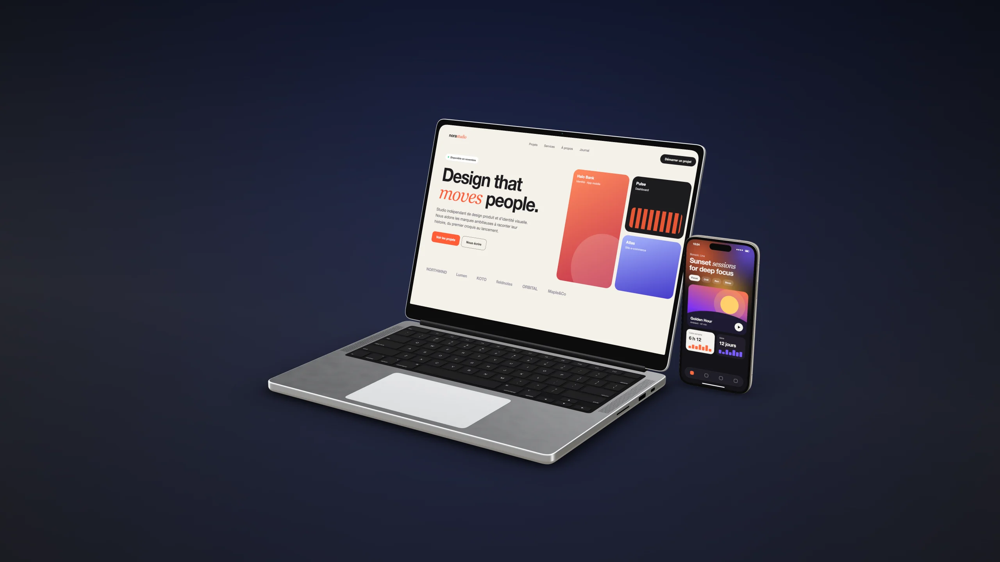
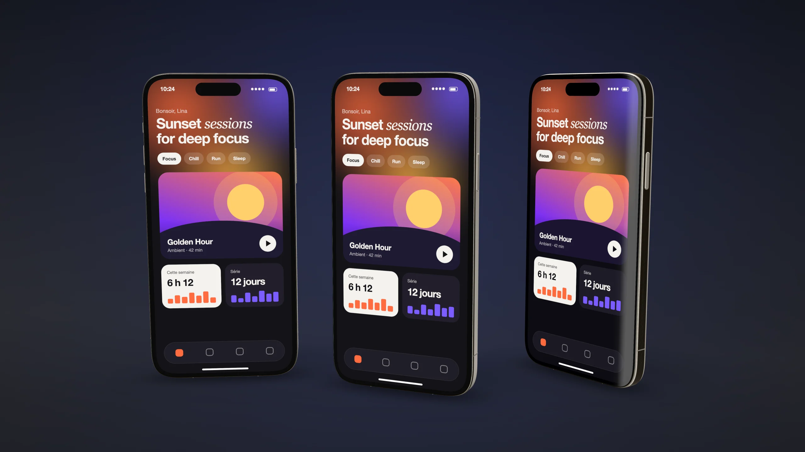
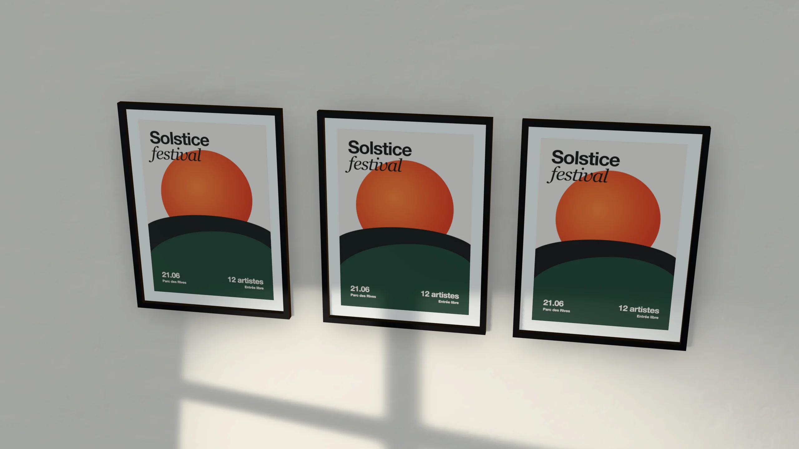
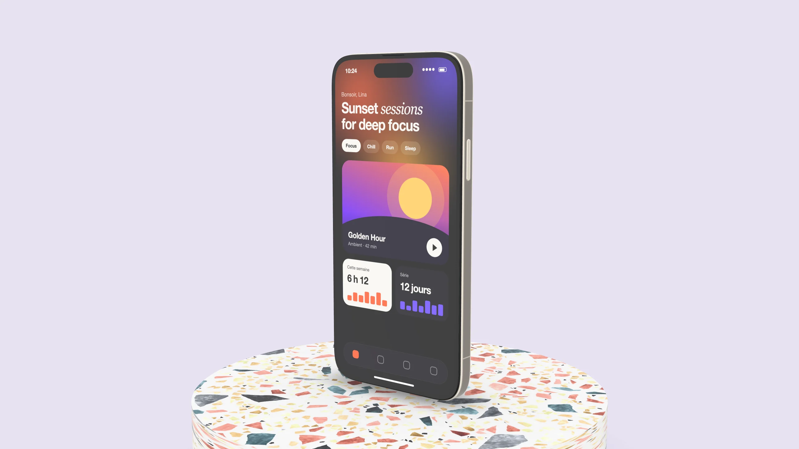
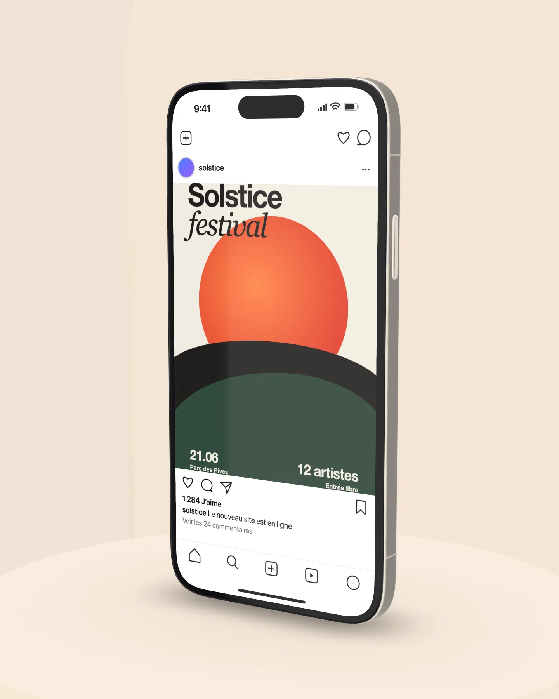
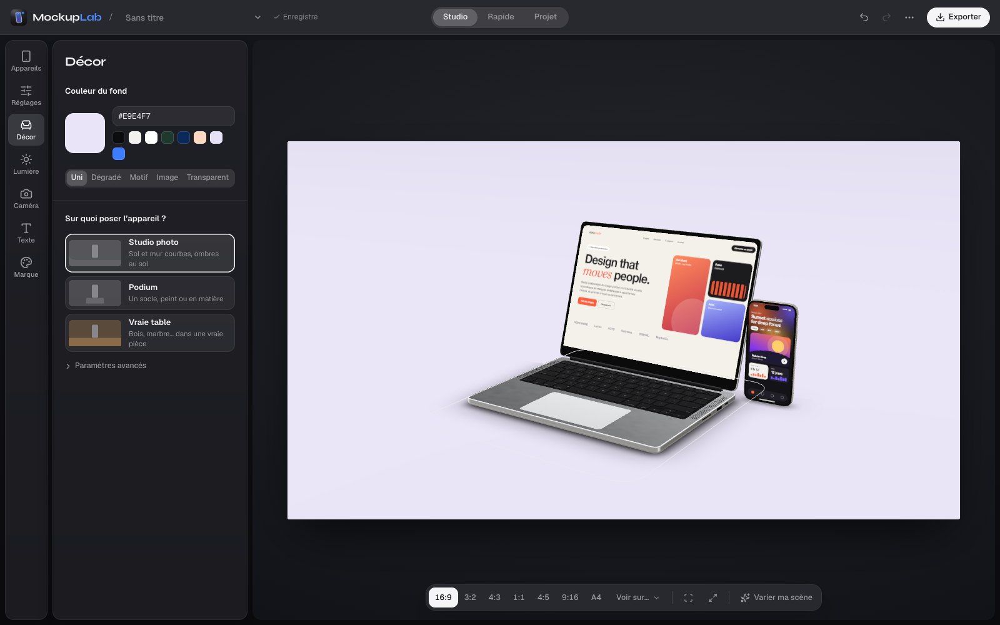

# MockupLab

**Mets tes designs en scène sur de vrais appareils, en 3D, en quelques secondes.**
Gratuit, open source, et tout se passe dans ton navigateur : tes images ne quittent jamais ton ordinateur.

<p align="center">
  
</p>

<p align="center">
  <a href="https://lucaleone15.github.io/MockupLab/"><b>Ouvrir MockupLab dans le navigateur</b></a>
  &nbsp;·&nbsp;
  <a href="https://github.com/lucaleone15/MockupLab/releases/latest">Télécharger pour Mac ou Windows</a>
</p>

## Ce que ça fait

- **Glisse une capture, obtiens un mock-up photoréaliste** : téléphones, tablettes, ordinateurs, écrans, montre, navigateur.
- **Le print aussi** : affiches, flyers, cartes de visite, magazines, livres, badges, roll-up, chacun au vrai format.
- **Un vrai studio photo** : fond à ta couleur, podium ou vraie table (bois, marbre, travertin), lumière de studio.
- **Les réseaux sociaux** : ton visuel dans un post, une story ou un Reel, sur un vrai téléphone.
- **De la vidéo** : rotations, travellings, plongée dans l'écran, exportés en MP4 ou en GIF.
- **Export jusqu'en 4K**, en PNG, JPG ou WebP.

<table>
  <tr>
    <td width="50%"></td>
    <td width="50%"></td>
  </tr>
  <tr>
    <td width="50%"></td>
    <td width="50%"></td>
  </tr>
</table>

## Trois façons de créer

| | |
|---|---|
| **Studio** | Ta scène 3D, réglée dans le moindre détail : appareils, décor, lumière, caméra, vidéo. |
| **Rapide** | Une image, et des mock-ups tout faits. Tu choisis, tu télécharges. |
| **Projet** | Tous les visuels d'un client en un pack assorti, avec sa planche de présentation. |

<p align="center">
  
</p>

## Comment l'utiliser

1. Ouvre le Studio et glisse ton image (ou colle-la avec ⌘V / Ctrl+V).
2. Choisis l'appareil, le décor et la lumière.
3. Clique sur **Exporter** : image ou vidéo.

Tes projets s'enregistrent tout seuls dans ton navigateur, et chaque export garde ses réglages pour être repris plus tard.

## Installer

- **Dans le navigateur** : [lucaleone15.github.io/MockupLab](https://lucaleone15.github.io/MockupLab/). Le site s'installe comme une app et marche hors ligne.
- **Mac et Windows** : la dernière version est dans les [Releases](https://github.com/lucaleone15/MockupLab/releases/latest) (`MockupLab-Mac.dmg`, `MockupLab-Windows.exe`). L'app se met à jour toute seule.
  - Mac : au premier lancement, clic droit sur l'app › Ouvrir (elle n'est pas encore signée par Apple).
  - Windows : si SmartScreen s'affiche, « Informations complémentaires » › « Exécuter quand même ».

## Développement

Il faut Node.js 20 ou plus récent.

```bash
npm install
npm run dev      # http://localhost:5173
npm run build    # version de production dans dist/
```

Fait avec React, Three.js (React Three Fiber), Tailwind CSS et Vite. Le site est publié sur GitHub Pages à chaque envoi sur `main`. Pour publier les apps, augmente `version` dans `desktop/package.json` puis pousse un tag `vX.Y.Z`.

## Licence

[MIT](LICENSE)

---

<sub>English: MockupLab is a free, open-source 3D mock-up generator that runs entirely in your browser. Drop a screenshot, place it on a real device, in a real photo studio, and export images up to 4K or videos. Nothing is uploaded. The interface is in French and English.</sub>
